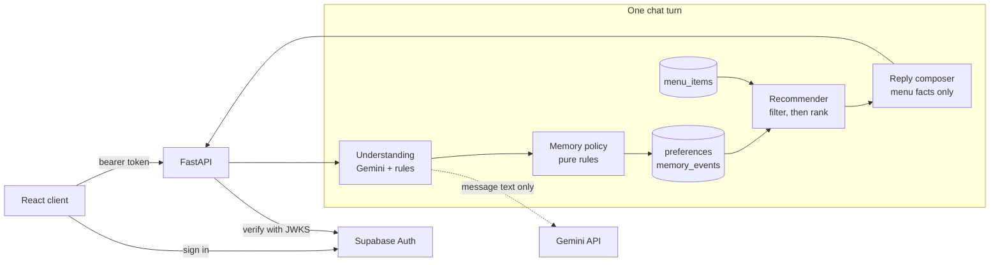
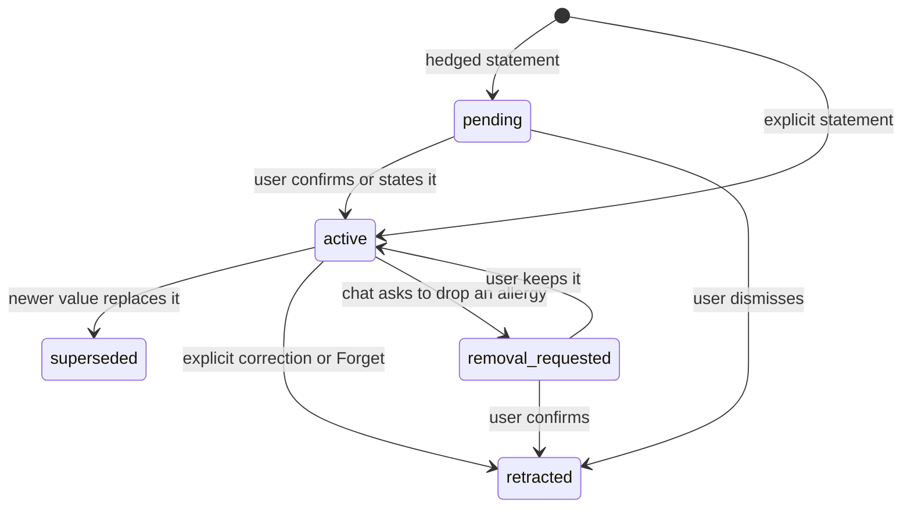

# Architecture

One FastAPI service serves the API and the built React client. Supabase provides
authentication and PostgreSQL. Gemini is optional and replaceable.

## A chat turn

1. `auth.py` verifies the token. The user id comes only from its `sub` claim.
2. `understanding/service.py` produces an `Understanding`: intent, candidate preferences,
   request constraints and dish names. This happens before a database transaction opens.
3. In one transaction, as the `authenticated` role:
   - the message is stored;
   - `memory/service.py` applies each candidate through the policy;
   - request constraints are merged with the conversation's context;
   - the recommender runs on current memory and menu rows;
   - the reply and its structured payload are stored.

A failure part-way rolls the whole turn back, so memory and chat history cannot disagree.

## Understanding

Gemini returns JSON against a schema, validated by Pydantic. Three safeguards apply before
the policy sees it:

- A preference must quote words that appear in the message, otherwise it is dropped.
- Allergy statements and price limits found by the rules are added if the model missed
  them. A live Gemini call dropped a price limit, which prompted the second part.
- A hedged diet statement cannot be upgraded to certain by the model.

Any HTTP error, timeout or invalid response falls back to the rules, and the interface says
so.

## Memory

`memory/policy.py` is a pure function: candidate plus current records in, changes and
user-visible notes out. `memory/service.py` is the only code that writes preferences, and it
takes a per-user advisory lock so concurrent messages cannot create contradictory records.

(`removal_requested` is a flag on an active record, shown as a state for clarity.)

| Statement | Effect |
| --- | --- |
| "I'm allergic to nuts" | active peanut and tree-nut allergies |
| "I think I might be allergic to sesame" | pending; excluded as a precaution |
| "I'm not allergic to peanuts anymore" | flagged; still enforced |
| "I'm vegan" after "vegetarian" | vegetarian superseded, other records untouched |
| "I don't eat much meat" | vegetarian proposed, not enforced |
| "Today I want something spicy" | conversation context only |
| "My wife is allergic to sesame" | enforced for this chat only; not saved to the profile |
| "I love chicken" while vegetarian | not saved; asks whether the diet changed |

Short-term state ("today", "cheaper than that") lives in `conversations.context`, separate
from long-term memory.

Retrieval is a query for the user's live records. A diner has tens of preferences at most,
so all of them are relevant enough to load; semantic search would add failure modes
without adding recall.

## Recommendation

`recommendation/engine.py` is pure.

**Hard exclusions:** unavailable; allergen in `allergens` or `may_contain`; incomplete
allergen data when the diner has any allergy; diet not met; disliked or avoided food; over
budget.

**Ranking of survivors:** requested food (+5), liked ingredient (+3 each), saved favourite
(+3), preferred cuisine (+2), spice distance (penalty), small boost for mains. Ties break by
price then name, so results are repeatable.

Ranking never receives an excluded dish.

## Security

- Tokens: algorithm allow-list, issuer, audience, expiry and role are all checked.
- Every user query runs as `authenticated` with the user id set for the transaction, so
  Row Level Security applies even if a query omits its filter.
- Tables sit in the `app` schema, which Supabase's public Data API does not expose.
- All SQL is parameterised. Input lengths are bounded. Chat is rate limited per user.
- The model receives only the current message text, never ids or stored memory.
- The browser gets only the Supabase publishable key.
