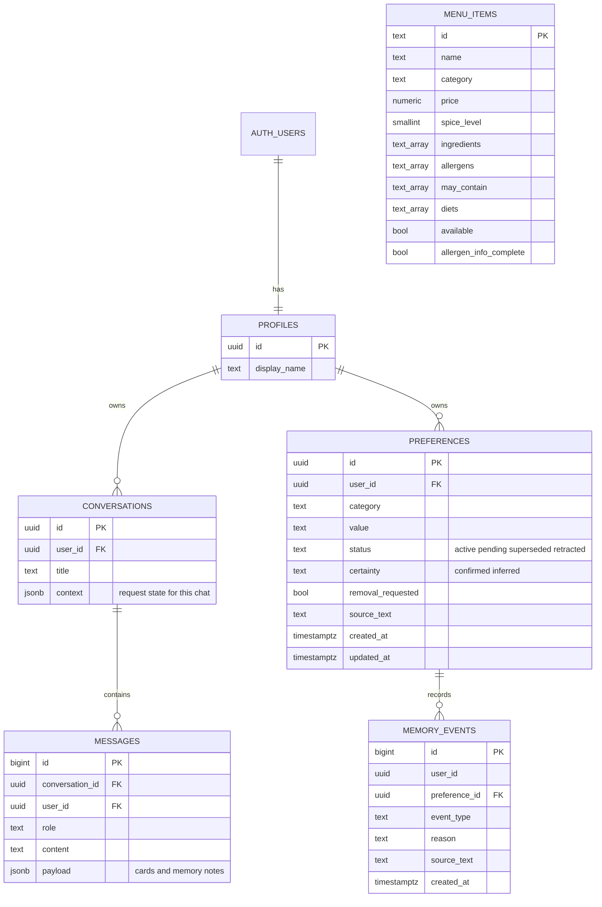

# Database schema

The source of truth is
[`supabase/migrations/0001_schema.sql`](../supabase/migrations/0001_schema.sql).

## Integrity rules enforced by the database

| Rule | Mechanism |
| --- | --- |
| One live record per user, category and value | partial unique index |
| A message cannot join another user's conversation | composite key `(conversation_id, user_id)` |
| A history event cannot point at another user's preference | composite key `(preference_id, user_id)` |
| History cannot be edited or deleted | only `select` and `insert` granted |
| Preferences are never deleted, only re-statused | no `delete` grant |
| Users see and change only their own rows | Row Level Security on every table |
| The menu is read-only to users | `select` grant and policy only |

The composite keys matter because foreign key checks bypass Row Level Security.

## Provenance

Each preference keeps the sentence that created it. Each change adds an event with its type,
reason, triggering sentence and time. That history is what the "How it changed" panel shows.
