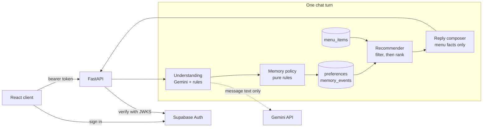
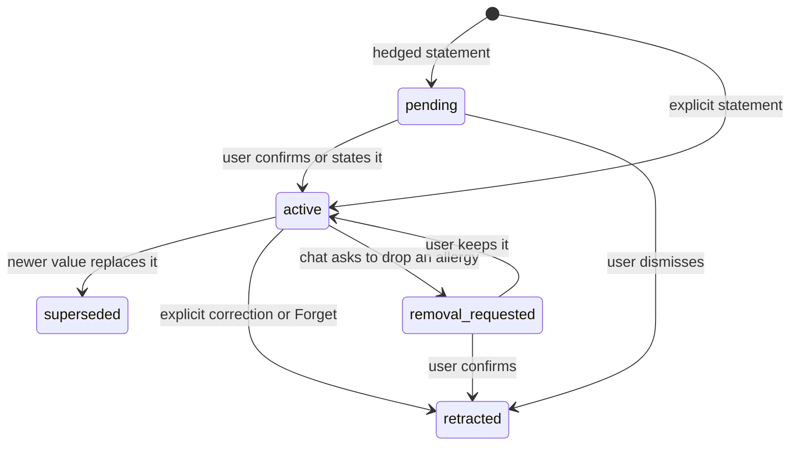

# Architecture

One FastAPI service serves the API and the built React client. Supabase provides
authentication and PostgreSQL. Gemini is optional and replaceable.

## Where things live

| Responsibility | Code |
| --- | --- |
| HTTP routes, input validation | `backend/app/api.py` |
| Token verification | `backend/app/auth.py` |
| Database sessions and Row Level Security context | `backend/app/db.py` |
| Reading a message | `backend/app/understanding/` |
| Deciding and storing memory | `backend/app/memory/` |
| Filtering and ranking | `backend/app/recommendation/` |
| One chat turn and reply text | `backend/app/chat/` |
| Shared food and allergen words | `backend/app/vocabulary.py` |
| Screens: chat, menu, preferences, comparison | `frontend/src/components/` |

The browser holds no business rules. It signs in, calls the API and renders what it
returns.

## A chat turn

1. `auth.py` verifies the token. The user id comes only from its `sub` claim.
2. `understanding/service.py` produces an `Understanding`: intent, candidate preferences,
   request constraints and dish names. This happens before a database transaction opens.
3. In one transaction, as the `authenticated` role:
   - the message is stored;
   - `memory/service.py` applies each candidate through the policy;
   - request constraints are merged with the conversation's context;
   - the recommender runs on current memory and menu rows;
   - the reply and its structured payload are stored.

A failure part-way rolls the whole turn back, so memory and chat history cannot disagree.

## Understanding

Gemini returns JSON against a schema, validated by Pydantic. `_reconcile` then applies
these safeguards before the policy sees anything:

- A preference must quote words that appear in the message, otherwise it is dropped.
- A statement about someone else is dropped from memory. If it is an allergy, it applies to
  this conversation.
- Allergies, spice limits and price limits that the rules found and the model missed are
  added back.
- Hedged wording cannot become certain.
- A saved diet can only be set aside for a conversation if the message mentions it.

Any HTTP error, timeout or invalid response falls back to the rules, and the interface says
so. The log records which engine read each turn, never the message.

## Memory

`memory/policy.py` is a pure function: candidate plus current records in, changes and
user-visible notes out. `memory/service.py` is the only code that writes preferences, and it
takes a per-user advisory lock so concurrent messages cannot create contradictory records.

(`removal_requested` is a flag on an active record, shown as a state for clarity.)

| Statement | Effect |
| --- | --- |
| "I'm allergic to nuts" | active peanut and tree-nut allergies |
| "I think I might be allergic to sesame" | pending; excluded as a precaution |
| "I'm not allergic to peanuts anymore" | flagged; still enforced |
| "I'm vegan" after "vegetarian" | vegetarian superseded, other records untouched |
| "I don't eat much meat" | vegetarian proposed, not enforced |
| "Today I want something spicy" | conversation context only |
| "My wife is allergic to sesame" | enforced for this chat only; not saved to the profile |
| "I love chicken" while vegetarian | not saved; asks whether the diet changed |

Short-term state ("today", "cheaper than that", other diners' allergies) lives in
`conversations.context`, separate from long-term memory.

Retrieval is a query for the user's live records. A diner has tens of preferences at most,
so all of them are relevant enough to load; semantic search would add failure modes
without adding recall.

## Recommendation

`recommendation/engine.py` is pure.

**Hard exclusions:** unavailable; allergen in `allergens` or `may_contain`; incomplete
allergen data when anyone at the table has an allergy; diet not met; disliked or avoided
food; over budget.

**Ranking of survivors:** requested food (+5), liked ingredient (+3 each), saved favourite
(+3), preferred cuisine (+2), spice distance (penalty), small boost for mains. Ties break by
price then name, so results are repeatable.

Ranking never receives an excluded dish. Each card lists the reasons it was chosen.

## Security

- Tokens: algorithm allow-list, issuer, audience, expiry and role are all checked.
- Every user query runs as `authenticated` with the user id set for the transaction, so
  Row Level Security applies even if a query omits its filter. See
  [database.md](database.md).
- Tables sit in the `app` schema, which Supabase's public Data API does not expose.
- All SQL is parameterised. Input lengths are bounded. Chat is rate limited per user.
- The model receives only the current message text, never ids or stored memory.
- The browser gets only the Supabase publishable key.
